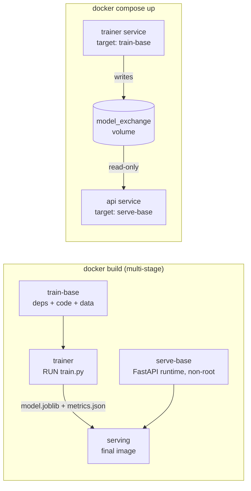

# Containerized Churn Prediction API

[](https://github.com/jaira26/docker-churn-api/actions/workflows/docker-ci.yml)

A customer churn model for the IBM Telco dataset, trained and served in Docker. The project builds on Lab 2 of the Docker Labs in [raminmohammadi/MLOps](https://github.com/raminmohammadi/MLOps/tree/main/Labs/Docker_Labs/Lab2) and keeps its two core ideas:

- a multi-stage build that trains in one stage and ships only the model, and
- a two-container Compose setup where a trainer hands the model to a server through a shared volume.

Everything else is rebuilt: the dataset, model, serving framework, image design, and testing.

## Architecture



The single Dockerfile serves both run modes. `docker build` produces a self-contained image with the model baked in. Compose reuses two intermediate stages: it retrains at startup and serves the fresh model from the shared volume, so retraining never requires rebuilding the serving image.

## What changed from the original lab

| Area | Original Lab 2 | This version | Why |
|---|---|---|---|
| Data | Iris (150 rows) | Telco Customer Churn (7,043 customers, 19 features) | Real business problem with class imbalance and mixed feature types |
| Model | Keras dense network | scikit-learn pipeline; logistic regression vs gradient boosting chosen by 5-fold CV | Strong tabular baselines with no TensorFlow dependency |
| Preprocessing | `StandardScaler` fit in training but not saved; the server scores raw inputs | Scaling and one-hot encoding saved inside the model pipeline | Fixes training/serving skew |
| Evaluation | Accuracy on the validation split | ROC-AUC, precision, recall, F1, confusion matrix on a held-out test split | Accuracy is misleading at a ~26% churn rate |
| Serving | Flask, listening on port 4000 | FastAPI with Uvicorn on port 8000 | The original exposes and maps port 80 while the app listens on 4000, so it is unreachable from the host |
| Input handling | Unvalidated form fields; errors return HTTP 200 | Pydantic schema with allowed values; bad input returns 422 | Invalid requests are rejected instead of scored |
| Endpoints | `/predict` | `/predict`, `/health`, `/model-info`, `/docs`, HTML form at `/` | Health checks, model transparency, auto-generated API docs |
| Images | Full `python:3.10` base, TensorFlow in the serving image | `python:3.11-slim`, separate train and serve requirements | Much smaller serving image (see the size table) |
| Security | Runs as root, Flask debug mode on | Non-root user, debug off | Standard container hardening |
| Health | None | Docker `HEALTHCHECK` on `/health`; the app refuses to start without a model | Orchestrators can detect a broken container |
| Compose | `pip install` on every container start | Images are built once; Compose only runs them | Faster startup, reproducible environments |
| Dependencies | Mostly unpinned | Every package pinned | Training and serving use the same scikit-learn version |
| CI | None | GitHub Actions builds the image and smoke-tests both run modes | Every push is checked automatically |

## Setup

1. Download the dataset from Kaggle: *Telco Customer Churn* (blastchar/telco-customer-churn).
2. Rename `WA_Fn-UseC_-Telco-Customer-Churn.csv` to `telco_churn.csv` and place it in `data/`.

## Run option 1: multi-stage build

```sh
docker build -t churn-api .
docker run -p 8000:8000 churn-api
```

The model trains during the build. Open http://localhost:8000.

## Run option 2: Docker Compose

```sh
docker compose up --build
```

The `trainer` container trains, writes `model.joblib` and `metrics.json` to the `model_exchange` volume, and exits. The `api` container starts only after training succeeds and mounts the volume read-only. To retrain on new data, replace the CSV and run `docker compose up --build` again.

Tear down, including the volume:

```sh
docker compose down -v
```

## Using the API

```sh
curl -X POST http://localhost:8000/predict \
  -H "Content-Type: application/json" \
  --data @scripts/sample_customer.json
```

The response looks like this (the probability depends on your trained model):

```json
{"churn_probability": 0.9139, "will_churn": true, "threshold": 0.5, "model": "logistic_regression"}
```

| Endpoint | Method | Purpose |
|---|---|---|
| `/` | GET | Form for scoring one customer |
| `/predict` | POST | Churn probability for one customer (JSON) |
| `/health` | GET | Liveness check |
| `/model-info` | GET | Selected model, CV scores, test metrics, training timestamp |
| `/docs` | GET | Interactive OpenAPI docs |

The decision threshold defaults to 0.5. Override it with `CHURN_THRESHOLD`, for example `docker run -e CHURN_THRESHOLD=0.35 -p 8000:8000 churn-api`, to trade precision for recall.

## Results

Trained on 5,634 customers and evaluated on 1,409 held-out customers (26.5% churn rate).

| Metric | Value |
|---|---|
| Selected model | Logistic regression |
| CV ROC-AUC (logistic regression) | 0.846 ± 0.012 |
| CV ROC-AUC (gradient boosting) | 0.844 ± 0.009 |
| Test ROC-AUC | 0.842 |
| Test recall | 0.783 (293 of 374 churners caught) |
| Test precision | 0.504 |

The two candidates are within one standard deviation of each other in cross-validation, so the simpler, more interpretable model was kept. Balanced class weights favor recall over precision, which suits retention work: missing a churner usually costs more than an unneeded retention offer.

## Image size comparison

Measured with `docker image ls` on Docker Desktop (Windows, WSL 2).

| Image | Disk usage | Content size |
|---|---|---|
| Original Lab 2 serving image (`python:3.10` + TensorFlow) | 5.36 GB | 1.64 GB |
| This project's serving image (`python:3.11-slim` + scikit-learn) | 696 MB | 159 MB |

About 87% smaller on disk and about 10x smaller compressed.

## Testing

`scripts/smoke_test.sh` starts a container, waits for it to report healthy, checks that `/predict` returns a probability, and checks that invalid input gets a 422.

```sh
docker build -t churn-api .
bash scripts/smoke_test.sh churn-api
```

The GitHub Actions workflow in `.github/workflows/docker-ci.yml` runs the same checks plus the full Compose stack on every push to `main`.

## Project structure

```
.
├── Dockerfile               # 4 stages: train-base, trainer, serve-base, serving
├── docker-compose.yml       # trainer + api sharing the model_exchange volume
├── requirements-train.txt
├── requirements-serve.txt
├── data/
│   └── telco_churn.csv      # IBM Telco Customer Churn (Kaggle)
├── src/
│   ├── train.py             # CV model selection, test evaluation, artifact export
│   ├── app.py               # FastAPI app
│   ├── templates/index.html
│   └── statics/             # style.css, app.js
├── scripts/
│   ├── smoke_test.sh
│   └── sample_customer.json
└── .github/workflows/docker-ci.yml
```